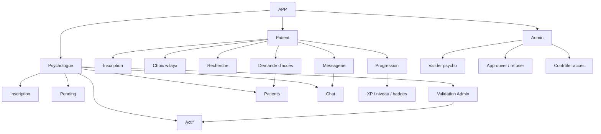
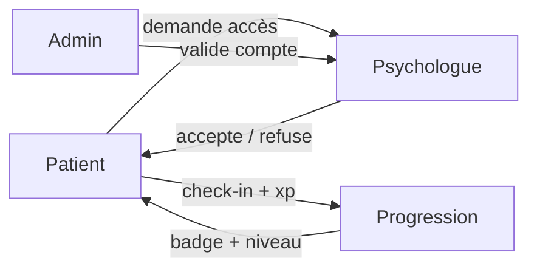

# INDEX DES SCHÉMAS

## FICHIERS

- [01_WORKFLOW_ORGANIGRAMME.md](01_WORKFLOW_ORGANIGRAMME.md) — vue globale visuelle
- [02_WORKFLOW_PRESENTATION_CLIENT.md](02_WORKFLOW_PRESENTATION_CLIENT.md) — vue client / présentation
- [03_WORKFLOW_ETATS_COMPTES.md](03_WORKFLOW_ETATS_COMPTES.md) — états des comptes
- [04_WORKFLOW_PROGRESSION_BADGES.md](04_WORKFLOW_PROGRESSION_BADGES.md) — progression / badges / humeur

## RELATION PRINCIPALE

