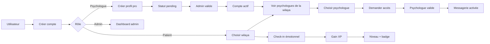
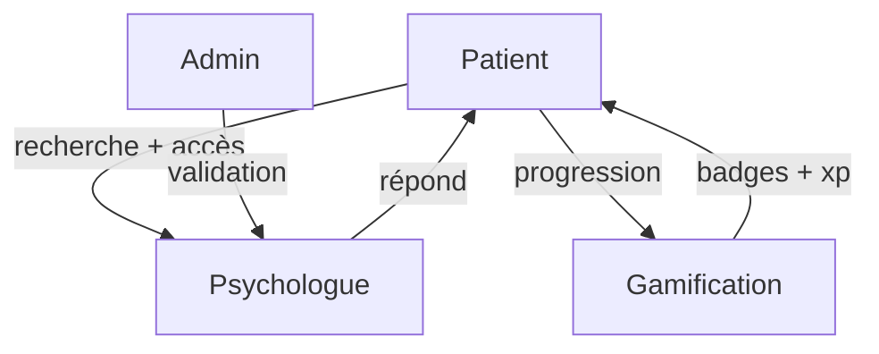

# SCHÉMA CLIENT - VUE PRÉSENTATION

## MISSION DU SYSTÈME

- Trouver le bon psychologue selon la wilaya
- Valider les comptes professionnels
- Sécuriser les accès
- Activer la messagerie uniquement après accord
- Suivre la progression du patient
- Motiver grâce aux badges et au niveau